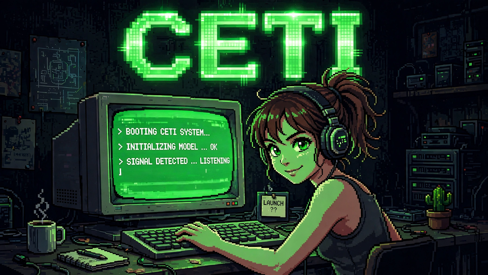
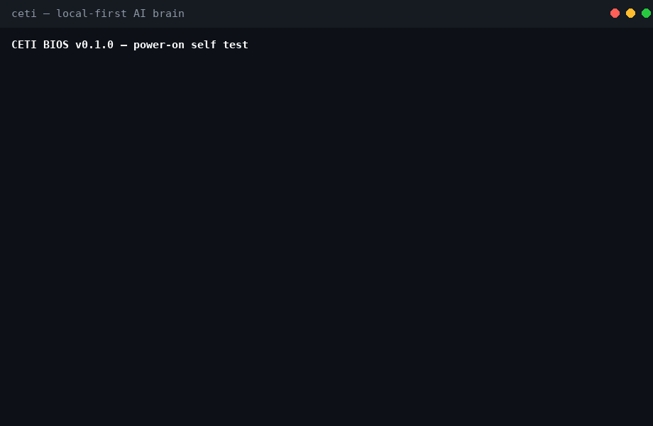

# CETI

**A sovereign local brain.**  
The datasets are the mind. The models are only the handlers.

CETI answers from knowledge that lives on your iron first — AIML cassettes, then a local vector memory of curated Q&A. A small local model presents what was retrieved. Cloud models are a last-resort oracle, and even then they receive only a PII-stripped query. Every answer worth keeping is classified, distilled, signed, and returned to the local knowledge base.

No accounts. No telemetry. No landlord. It runs on a tired laptop.





---

## Quick start

```bash
unzip ceti-0.3.1.zip
cd ceti-0.3.1

./install.sh
source ./ceti-env.sh
./run.sh
```

`install.sh` sets up the virtual environment, installs the single hard dependency (`ecdsa`), optionally installs Ollama and pulls the handler model, downloads the embedding model from Hugging Face (`ggml-org/embeddinggemma-2-GGUF`, Q8_0), fetches a `llama-server` binary for embeddings, asks for a node name (default CETI), generates the node identity (`data/identity.dat`), writes `ceti-env.sh`, and runs the boot self-test. Defaults cover everything — `./install.sh --yes` needs no expertise.

The `llama-server` fetch tries a pinned llama.cpp build (b11630, verified for the embedding model's architecture) and falls back to the latest nightly on download failure; if the binary does not know the model's architecture, re-run with `--build-llama` to build the latest llama.cpp from source (needs cmake + a C++ compiler + git, takes a while). A smoke test at the end proves the server embeds with the model before install declares success.

For a non-interactive or minimal install:

```bash
# Full stack, no prompts
./install.sh --yes

# Core only (AIML + sqlite memory). No Ollama, no models.
./install.sh --yes --no-ollama --no-models

# Bring your own models
./install.sh --yes \
  --embedding-model-url=https://example.com/embeddinggemma-2.gguf \
  --research-model-url=https://example.com/research-model.gguf
```

`run.sh` starts any local services that are present (Ollama, embedding server) and opens the REPL. Missing pieces degrade gracefully; the boot screen reports exactly what is available.

### After boot

```
CETI BIOS v0.3.1 — power-on self test
[  ok  ] config     data_dir=...
[  ok  ] persona    Persona (...)
[  ok  ] aiml       ... categories ...
[  ok  ] knowledge  ...
...
```

Type a question. Useful REPL commands:

| Command      | Purpose                                      |
|--------------|----------------------------------------------|
| `/tiers`     | Show the answer ladder and which tiers are live |
| `/trace`     | How the last answer was produced             |
| `/stats`     | Tier counts, learned totals, uptime          |
| `/identity`  | Node fingerprint and identity file           |
| `/agent`     | Agent name, pending tasks, knowledge gaps    |
| `/benchmark` | Self-exam of current knowledge               |
| `/heartbeat` | Toggle idle research tick                    |
| `/help`      | List all commands                            |
| `/research`  | Research config: sites, topics, interests, nightly budget |
| `/tools`     | List the tool registry                       |
| `/task`      | Hand the cloud oracle a task; it drives tools |
| `/oracle`    | Skip memory/local; answer from the cloud oracle |
| `/skills`    | List / reload SKILL.md bundles               |
| `/ingest`    | Scan `data/library/` into vector memory      |
| `/story`     | Oracle paper writer (new/write/status/compile/list) |
| `/tui`       | Full-screen terminal UI (sessions, streaming)      |
| `/new`       | Fresh chat in the TUI                              |
| `/sessions`  | List saved TUI chats                               |
| `/resume`    | Reopen a saved TUI chat                            |
| `/gopher`    | Retro menu: board, mail, chat, files               |
| `/peers`     | List known nodes                                   |
| `/board`     | Signed board posts                                 |
| `/mail`      | Signed direct messages                             |
| `/chat`      | Live signed chat room                              |
| `/upload`    | Share a signed file to the drop                    |
| `/download`  | Fetch a file from the drop                         |
| `/quit`      | Exit                                               |

---

## Requirements

- **Python 3.10+**
- **Linux or macOS** (the researcher’s memory gate is Linux-specific; elsewhere it is skipped)
- ~2 GB disk if you want the full model stack. The brain itself is a few hundred kilobytes.
- RAM: the core runs in tens of megabytes. Research cycles prefer ~1 GB free and will skip if memory is low.

Optional backends (all degrade cleanly):

| Backend              | Purpose                          | Notes                                      |
|----------------------|----------------------------------|--------------------------------------------|
| Ollama               | Local handler model              | Default: `qwen2.5-coder:1.5b` (~1 GB)     |
| embedding GGUF       | Vector memory                    | 768-dim, e.g. embeddinggemma-2. Falls back to sqlite TF-IDF |
| Research model       | Idle research distillation       | Any ~2–3B instruct model registered in Ollama |

Nothing phones home.

---

## How it answers

Every question walks a ladder. The first tier that knows the answer wins.

| Tier   | Backend                                      | Typical latency | Notes                                      |
|--------|----------------------------------------------|-----------------|--------------------------------------------|
| Calc   | Deterministic Python evaluator               | ~0 ms           | Math never reaches a model                 |
| AIML   | Hot-reloadable pattern cassettes             | ~0 ms           | Typo- and paraphrase-tolerant              |
| Memory | Local vector search over curated Q&A         | ~1–3 s          | sqlite TF-IDF fallback if no embeddings    |
| Local  | Small model via Ollama (handler mode)        | ~5–30 s         | Sees the raw query; never leaves the box   |
| Cloud  | OpenRouter / Nvidia (oracle)                 | —               | Receives only the PII-stripped query       |

In handler mode the local model is instructed to present retrieved knowledge rather than generate freely. A deterministic numbers-grounding guard rejects rewrites that invent figures and falls back to the raw retrieved text.

---

## The learning loop

1. The ladder answers.
2. Every generated answer is scored by the relevance classifier:
   - **≥ 0.65** → promote (fact layer + raw pair, below)
   - **0.45–0.65** → local adjudication
   - **< 0.45** → discard
3. Promoted knowledge accumulates until you cut a signed release.
4. Questions that repeatedly fail become curiosity tasks for the idle researcher.

Learning is two-layer. The **fact layer** distills a (question,
answer) into a structured fact — (subject, predicate, object) +
confidence + source — stored in `data/facts.sqlite3`. One fact
compiles to several AIML paraphrase patterns, so any wording that
means the same thing answers from the same fact. A conflicting
fact with >= confidence blocks the learn (same meaning, different
wording — the old exact-question check missed that). The
**raw-pair layer** (unchanged) still writes the pair to
`learned.aiml` + the vector memory, so pairs that don't extract
to a fact are never lost. See `docs/facts.md`.

The idle researcher (auto-learn) routes distilled pairs through
the same fact layer before writing them to a cassette — a
conflicting distilled pair is dropped, never shipped. The memory
tier's handler is grounding-checked on numbers AND words: an
answer that invents most of its words falls back to the raw
retrieved text.

Relevance alone never proves truth — a confident confabulation
scores like a true fact. So learning has two more gates before
anything enters permanent memory:

- **Truth judge (factual answers only).** A "promote" still needs
  one verification call: the local model is asked whether the
  claim is correct, and must answer YES (unsure votes NO). A NO,
  or a failed judge, blocks learning. Serving is unchanged —
  the answer is still shown; only learning is gated.
- **Contradiction check.** Before writing, the new pair is
  compared against existing knowledge: the memory store (same
  question) and the AIML engine (what it already answers,
  cassettes included). A genuine disagreement blocks the write
  and files a curiosity gap, so research can resolve it —
  curated knowledge is never silently overridden by a model
  guess. An elaboration (one answer contains the other) is not
  a conflict.

Neither gate is a guarantee — the truth judge is the same
small model checking its own output. Ground truth stays the
job of cassettes, research, and the contradiction check.

The idle researcher walks `data/topics.txt` (broad, encyclopedic subjects). It researches, distills into Q&A, classifies, and writes accepted pairs into a topic cassette and the vector store. Completed topics are skipped. Cassettes hot-reload.

---

## Identity and signed knowledge

On first run CETI generates a node identity (`data/identity.dat`, mode 0600). Only the public fingerprint is ever shared. The private key signs dataset releases.

Knowledge ships as signed, chained, merkle-rooted bundles:

1. sha256 per file, merkle root over sorted hashes
2. each manifest carries `prev_hash` (version ledger)
3. ECDSA (deterministic secp256k1) signature over the canonical manifest
4. gzip-packed tarball + pure-stdlib torrent/magnet

Peers verify the signature before merge. No signature, no trust. Merge is by record identity with score-based conflict resolution.

---

## Agent

CETI is a named, persistent agent with a task queue:

- Research, benchmark, curiosity, ingest, and release tasks
- Tasks persist in sqlite and survive restarts
- The REPL heartbeat triggers a tick after ten quiet minutes
- Self-benchmark quizzes every known question (exact, lowercased, and with a real typo)
- Curiosity turns repeated failures into research tasks

### Research — sites, topics, interests, nightly budget

Idle learning is governed by `data/research.json`, managed from the
REPL with `/research`:

- **Sites** — content is fetched ONLY from these hosts (exact host or
  subdomain). Default: `en.wikipedia.org`. Add one with
  `/research sites add <domain>`; the fetcher drops off-list results
  before any fetch, so no surprise hosts are ever read. This replaced
  the old Wikipedia-only switch: Jero adds a site explicitly, and
  only then may it be touched.
- **Topics** — the one-shot queue in `data/topics.txt`
  (`/research topics add|remove <topic>`).
- **Interests** — evergreen areas (`/research interests add|remove`).
  When the topic queue runs dry, the researcher cycles interests
  least-recent first instead of stopping.
- **Nightly budget** — `/research budget [max_topics N] [max_qa N]
  [max_minutes N]` (defaults 5 / 40 / 120). The nightly run stops
  when any cap is hit. With the default Wikipedia-only allowlist the
  stack runs its `--wiki-only` fast path, so an older research stack
  still works; custom sites need the stack's `--allow-sites` flag.

### `/task` — the oracle drives tools

`/task <description>` hands a cloud oracle the tool registry and a
sandbox. It plans, calls tools (file ops, sandboxed Python,
background jobs, session notes), observes results, and iterates
until done — then reports back. Per-session memory lives in
`data/sessions/<id>/` (`notes.json` + `messages.jsonl`); past the
token limit, assistant/tool rounds summarize while user messages
are never touched. Needs a cloud API key or it refuses loudly.

The sandbox is pure-Python Linux namespaces: read-only system
binds, no network, private `/work`, resource limits, wall-clock
kill. Background jobs (`run_python_bg` / `job_poll` / `job_kill`)
survive long runs.

### C2 console tools + key auth

The registry also carries the command-and-control desk:
`dictionary`, `thesaurus`, `memopad` (append/read/clear a
timestamped scratch pad), and `weather` (live, fails loud — never
invents a forecast). Drive them with `/call <tool> key=value ...`
or let `/task` use them.

`ceti/keyauth.py` is simple key authentication on the regula-core
identity: issue a challenge, sign it with the node key, verify
against the public key. No passwords, no shared secrets; a
signature for one challenge authenticates nothing else.
`python -m ceti.keyauth` runs the round-trip demo (both negative
cases rejected).

### Skills

`skills/` holds SKILL.md bundles — markdown + code the agent can
hot-load like cassettes: `file-ops`, `sandbox-python`,
`web-fetch`, `sqlite`. The agent loop sees them in its system
prompt; `/skills` lists, `/skills reload` rescans.

---

## Library & paper writer

Drop source material into `data/library/` (`.pdf` via
`pdftotext`, `.txt`, `.md`) and `/ingest` chunks it
(~600 tokens, paragraph-aware), embeds it with embeddinggemma-2,
and stores it in `data/library.sqlite3` — a document vector
memory separate from the Q&A base. Files are tracked by sha256;
re-drops are skipped.

`/story` is the oracle paper writer (StoryBlocks-style): `/story
new <premise>` writes a story bible (title, characters, arc, 12
chapter beats); `/story write <id> [pages] [count]` generates
blocks at ~200 words/page with retry-if-short; coherence comes
from the bible, rolling chapter summaries, and top-k library
chunks used as *style reference* — voice inspiration, never
reproduced. Stories compile to `story.md`/`story.txt` under
`data/stories/<id>/`. A 50-page run is an overnight job.

---

## Terminal UI

`/tui` opens a full-screen curses interface: header with the
node fingerprint and current chat title, scrollable transcript,
multiline input, slash-command autocomplete (Tab), history
(Up/Down), and Ctrl-C interrupt. Answers stream in — real
token-by-token chunks from model tiers, and a simulated 499 t/s
reveal for instant retrieval answers (the same cap the answer
tag uses). Enter during a stream interrupts and redirects,
like Hermes.

Chats are sessions, not a single transcript: `/new` starts a
fresh chat, `/sessions` lists saved ones, `/resume <id>` reopens
one, `/delete` removes one. Every line auto-saves to
`data/tui-sessions/`; a session with no real question never
gets a file. The line REPL stays as the fallback — `/task`
still bounces there, since tool calls don't run inside the
TUI yet.

## Gopher net

The node network is Gopher-flavoured: retro, plain-text, and
signed end to end. `/gopher` opens the menu.

- **Peers.** `/peers` lists known nodes; `/peer add <public_hex>`
  files a card. Node IDs are re-derived from the public key, so
  a card is self-verifying; the address is just a routing hint.
- **Nodelist + gossip.** `/nodelist build` signs the peer list
  to `data/nodelist.json`; `/nodelist fetch <url|file>` pulls
  someone else's. `/gossip export` / `/gossip import` exchange
  peer lists the same way. The whole list is refused if any
  entry fails verification; notes are stripped before
  publishing — only public routing info ships.
- **Board.** Signed posts, one JSON file each under
  `data/board/posts/`. Bad signatures are rejected, never
  displayed. `/board import <file>` is the federation
  primitive.
- **Mail.** `/mail <fingerprint> <subject> | <body>` sends a
  signed direct message. Sending to an unfiled stranger is
  refused; inbox messages addressed to someone else are
  skipped, never read.
- **Chat.** `/chat <room>` is a live signed chat room — one
  signed JSON file per message, polled every 2s. Two terminals
  sharing a room directory chat live.
- **Files.** `/upload <file>` shares a signed bundle and drops
  it in `data/drop/`; `/download` lists the drop and verifies
  + merges on fetch.

There is no live transport yet — cards, posts, and bundles
travel as files. Nodes find each other through the signed
nodelist (a well-known URL or shipped with a release) and
gossip from there.

---

## Configuration

Environment variables (set in `ceti-env.sh` or exported):

| Variable                     | Default                          | Purpose                          |
|------------------------------|----------------------------------|----------------------------------|
| `CETI_DATA_DIR`              | `./data`                         | Knowledge and identity location  |
| `CETI_FINGERPRINT_PREFIX`    | `CETI`                           | Identity tag (`JERO` for the Jero network) |
| `OPENROUTER_API_KEY`         | (unset)                          | Enables cloud oracle             |
| `NVIDIA_API_KEY`             | (unset)                          | Enables cloud oracle             |
| `CETI_EMBEDDING_MODEL`       | `./models/gguf/embeddinggemma-2.gguf` | Vector tier model           |
| `CETI_LLAMA_SERVER`          | `./bin/llama-server`             | Embedding server binary          |

The cloud tier stays disabled until keys are present.

---

## Project layout

```
ceti/               core package
  agent.py          named agent, task queue, tick loop
  agent_loop.py     /task: oracle-driven tool loop, session memory
  aiml.py           pattern matching and cassettes
  backends.py       Ollama, OpenRouter, Nvidia
  board.py          signed board posts
  boot.py           power-on self-test
  bus.py            unified memory bus — CETI as BIOS (see docs/bus.md)
  evals.py          fixed benchmarks: coding / tool / knowledge
  brain.py          answer ladder and learning loop
  calc.py           deterministic math tier
  chat.py           live signed chat room
  classify.py       relevance classifier
  gopher.py         /gopher text menu
  ingest.py         library drop-folder -> vector memory
  mail.py           signed direct messages
  memory.py         knowledge store
  nodelist.py       signed nodelist build/fetch/verify/merge
  notes.py          per-session notes
  peers.py          peer address book, identity cards
  researcher.py     idle research
  retry.py          backoff + retryable-error classification
  share.py          signed bundle share/fetch
  signing.py        identity, ECDSA, merkle
  skills.py         SKILL.md bundle loader
  story.py          oracle paper writer
  tools.py          jailed tool registry (+ sandbox jobs)
  trim.py           query-aware context compression (vendored model)
  trim_model.bin    trim-1 gradient-boosted trees (1.2 MB, Apache-2.0)
  tui.py            full-screen curses interface
  tui_sessions.py   saved TUI chats
  sandbox.py        Linux-namespace sandbox
  vectormem.py      local embeddings
data/               persona, seed, learned, cassettes, topics
skills/             file-ops, sandbox-python, web-fetch, sqlite
tests/              unit tests (485 green)
install.sh          one-shot setup
run.sh              launcher
```

---

## Development

```bash
# Run tests
.venv/bin/python -m unittest discover -s tests

# Boot self-test only
.venv/bin/python -m ceti.boot
```

The brain is stdlib-only except for `ecdsa` (signing). All other dependencies are optional backends.

---

## Security model

- No telemetry, no accounts, no remote control plane.
- Queries to the cloud oracle are PII-stripped first.
- Node private key never leaves the machine.
- Dataset releases are signed; peers reject unsigned or invalid bundles.
- Identity file is created mode 0600.

---

## Roadmap

- Live transport for the Gopher net (nodes poll; no inbound ports)
- Torrent seeding of signed bundles, auto-propagation, moderation
- Multi-signer web of trust and key revocation
- Agent-wired release → torrent → seed → verify → merge
- Tool calls inside the TUI (`/task` still bounces to the line REPL)
- Story branching (two-choice trees) in the paper writer
- QEMU sandbox backend behind the same SandboxPolicy

---

## Deeper docs

- [Design principles](docs/design-principles.md) — the rules the brain is built under
- [Oracle](docs/oracle.md) — the cloud tier's three jobs and two rules
- [Distribution](docs/distribution.md) — the torrent lifecycle and merge protocol
- [BBS front end](docs/bbs.md) — the three-phase board plan
- [Tools & sandbox](docs/tools-sandbox.md) — the agent's hands
- [Agent loop](docs/agent-loop.md) — `/task`, session memory, retry
- [Skills](docs/skills.md) — authoring SKILL.md bundles
- [Trim](docs/trim.md) — query-aware context compression, zero model tokens
- [Library & paper writer](docs/library-story.md) — ingest + `/story`
- [TUI](docs/tui.md) — full-screen terminal UI, sessions, streaming
- [Gopher net](docs/gopher.md) — signed peers, board, mail, chat, files
- [Security model](docs/security.md) — the four boundaries
- [Development](docs/development.md) — extending every seam, plus glossary
- [Troubleshooting](docs/troubleshooting.md) — when something's off

---

## License

MIT. See `LICENSE`.
